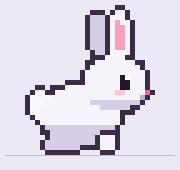
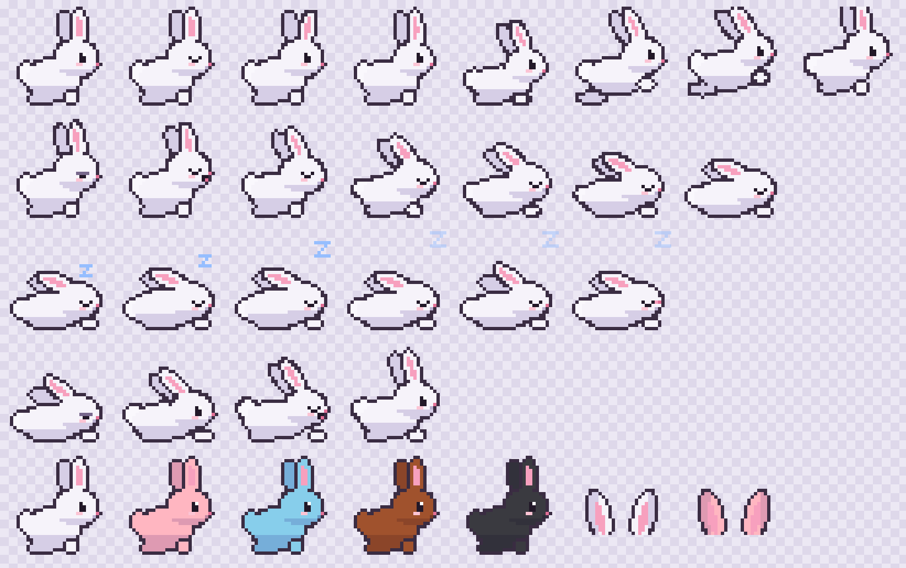

# BunnyBar 🐇

A tiny pixel-art bunny that lives above your action bar in **World of Warcraft: Forever**.

It hops back and forth on its own little track, blinks, twitches its ears and sometimes takes a nap. That's all it does. It doesn't automate anything, read combat data or touch your action buttons.





> **Screenshot placeholder:** an in-game capture is still to come. The images above use the actual sprites, the animated one with the addon's real frame timings.

## Features

- **Original pixel art**: a 32×32 white bunny with pink inner ears, drawn from code (`scripts/generate_sprites.py`) and rendered with nearest-neighbour filtering so pixels stay crisp.
- **Natural movement**: it waits 4–12 seconds, picks a random spot on its track and gets there in a series of small parabolic hops (crouch, jump, land). It faces the way it's going and never teleports.
- **Idle life**: blinking, ear twitches and breathing.
- **Naps**: now and then the bunny gets drowsy, yawns, curls up and sleeps, breathing slowly with a rising "z" and the odd ear or nose twitch. Then it wakes, stretches and sits up. Every step is a separate frame, so nothing snaps from pose to pose.
- **Unobtrusive**: an independent, click-through decorative frame drawn *below* the action-button layer. It never modifies or anchors to Blizzard's bars and never touches action buttons.
- **Finds its spot by itself**: it sits just above the highest visible bar at the bottom of the screen, whether that's Action Bar 2/3, the XP or reputation bar, or the main action bar. It moves on its own when you toggle bars, gain or lose the XP bar, change UI scale or edit your layout.
- **Options panel**: **Esc → Options → AddOns → BunnyBar** (or `/bunny options`) has a colour picker, size presets and portrait accessories. Everything applies instantly.
- **Any fur colour**: pick from a saturation/brightness square, a hue slider and a brightness slider, or type a hex code such as `#FFB6C1`. Only the fur changes: eyes, nose, pink inner ears, outlines and shading stay put in every animation frame.
- **Size presets**: Tiny (16), Small (32), Regular (64, the default for new installs), Large (96) or Huge (128). `/bunny size` still accepts any whole size from 16 to 128.
- **Bunny ears on portraits**: optional pixel-art ears on top of your own portrait and your party members' portraits, in the bunny's fur colour. They're purely local and cosmetic, and click-through.
- **Configurable**: speed, hop interval, track width and hop height too. You can drag it anywhere, and settings are saved per account.
- **Lightweight**: no per-frame work while sitting still. Updates run only during the ~0.4 s of each hop. No libraries, no network, about 230 KB of textures.

## Installation

1. Download `BunnyBar-<version>.zip` from the [latest release](https://github.com/aivarnit/BunnyBar/releases/latest).
2. Extract it into your WoW Forever AddOns folder so that you end up with `…/AddOns/BunnyBar/BunnyBar.toc`.

| OS | AddOns folder (default install) |
|---|---|
| **Windows** | `C:\Program Files (x86)\World of Warcraft\_forever_\Interface\AddOns\` |
| **macOS** | `/Applications/World of Warcraft/_forever_/Interface/AddOns/` |

3. Restart the game client completely. `/reload` doesn't always pick up a newly added addon.
4. On the character select screen, open **AddOns** and make sure **BunnyBar** is enabled.

Step-by-step instructions, including how to create a missing `AddOns` folder and how to find the folder via the Battle.net launcher, are in [docs/INSTALLATION.md](docs/INSTALLATION.md).

## Slash commands

| Command | What it does |
|---|---|
| `/bunny` | Show help |
| `/bunny options` | Open the BunnyBar settings panel |
| `/bunny color #FFB6C1` | Fur colour as a hex code; `/bunny color reset` restores the original |
| `/bunny show` | Show the bunny |
| `/bunny hide` | Hide the bunny (all animation stops) |
| `/bunny lock` | Lock the position (click-through) |
| `/bunny unlock` | Highlight the track and allow dragging |
| `/bunny reset` | Restore all default settings and position |
| `/bunny size 64` | Sprite size, 16–128. Presets: 16, 32, 64 (default), 96, 128 |
| `/bunny ears player off` | Turn portrait ears `on`/`off` for `player` or `party` |
| `/bunny speed 1.0` | Hop speed multiplier, 0.25–4 (default 1.0) |
| `/bunny interval 8` | Average seconds between hops, 2–120 (default 8) |
| `/bunny width 480` | Track width, 64–2000 (default 480) |
| `/bunny height 16` | Hop height, 0–64 (default 16) |
| `/bunny test` | Hop right now (a napping bunny wakes up first) |
| `/bunny stats` | Status, hop counters and performance info |
| `/bunny bars` | Show which bottom bars were detected and which one the bunny sits on |

`/bunnybar` works as an alias. A numeric command with no value, such as `/bunny size`, prints the current value. Full reference: [docs/COMMANDS.md](docs/COMMANDS.md).

## Compatibility

| | |
|---|---|
| Game | World of Warcraft: Forever (client 1.60.x) |
| TOC `## Interface` | `16001` |
| Platforms | Windows, macOS (Apple Silicon and Intel) |
| Dependencies | none |

WoW Forever runs on the modern (Midnight-era, 12.1.x) client and API, *not* the Classic Era API. BunnyBar uses long-standing frame, texture and timer APIs (`CreateFrame`, `SetTexture`, `SetTexCoord`, `SetVertexColor`, `C_Timer`), plus the modern `Settings` API for its options panel. Every optional API is guarded, with a fallback.

**Verification status:** v0.1 (the bunny, hops, naps and automatic placement above the bars) runs in WoW Forever without Lua errors and has passed in-game testing. **v0.2** adds the options panel, colours, size presets and portrait ears. It has passed static and offline checks only, and is **not yet verified in game**. The interface number and folder paths come from community sources published around the 4 November 2026 launch. See [docs/ARCHITECTURE.md](docs/ARCHITECTURE.md#compatibility-research) for sources and assumptions. If the client shows BunnyBar as *out of date*, a patch has probably raised the interface number. Tick **Load out of date AddOns** or open an issue.

## Performance

BunnyBar is designed to cost effectively nothing on a 2020 M1 MacBook Air:

- **Idle, napping and between hops:** no `OnUpdate` script at all. State changes and animation frames are scheduled with `C_Timer`: a few per minute while idle, and roughly 2 per second while asleep.
- **During a hop:** a single `OnUpdate` runs for ~0.4 s and is removed on landing. At default settings that's roughly 3–6 % of wall time.
- **Allocations:** no tables or closures are created per frame.
- **Hidden:** `/bunny hide`, or hiding the UI with Alt+Z, cancels every timer and update.
- **No** network, event polling, combat-log access or debug logging.

**Checking it yourself:** type `/bunny stats`. It reports how often per-frame updates were active, the addon's memory use, and the client's per-addon CPU average where the client exposes it (`C_AddOnProfiler`). For an A/B test, compare your frame rate with `/bunny hide` and `/bunny show`, or disable BunnyBar in the AddOns list.

## Development

Requirements: Python 3.9+ (standard library only) and LuaJIT or Lua 5.1 for the Lua checks (`brew install luajit` on macOS).

```sh
python3 scripts/generate_sprites.py            # regenerate textures + docs/images/sprite-preview.png
python3 scripts/validate.py -v                 # all static checks + offline Lua test-suite
python3 -m unittest discover -s tests -v       # tooling tests (incl. negative tests)
luajit tests/lua/run_tests.lua                 # offline Lua tests against a WoW API mock
python3 scripts/package.py                     # build + verify dist/BunnyBar-<version>.zip
```

To try your working copy in game, symlink the addon folder into your AddOns directory:

```sh
# macOS
ln -s "$PWD/addon/BunnyBar" "/Applications/World of Warcraft/_forever_/Interface/AddOns/BunnyBar"
```

```bat
:: Windows (cmd, as administrator)
mklink /D "C:\Program Files (x86)\World of Warcraft\_forever_\Interface\AddOns\BunnyBar" "%CD%\addon\BunnyBar"
```

The code layout and state machine are described in [docs/ARCHITECTURE.md](docs/ARCHITECTURE.md).

### Releasing

1. Bump `## Version:` in `addon/BunnyBar/BunnyBar.toc`.
2. Commit, then tag and push: `git tag v0.1.1 && git push origin v0.1.1`.
3. The [release workflow](.github/workflows/release.yml) validates, builds and verifies the ZIP. It publishes a GitHub Release only if every step passes and the tag matches the TOC version.

## Known limitations

- **v0.2 features aren't verified in game yet.** These are the options panel, colours, size presets and portrait ears. The animation, napping and automatic placement have passed in-game testing on WoW Forever. Everything is also checked offline against a mock of the WoW API. See the [in-game checklist](docs/ARCHITECTURE.md#manual-in-game-test-checklist).
- **Portrait ears** need Blizzard's default unit frames. Raid-style party frames have no portraits, so no ears appear there. Replacement unit frame addons aren't supported yet.
- **Very small sizes:** at 16 the 32-pixel art is scaled down 2×, so single-pixel details (eye shine, mouth) can drop out. Sizes 32, 64, 96 and 128 are whole multiples of the art (1×, 2×, 3×, 4×), so they're pixel-exact at UI scale 1.
- **Automatic placement relies on Blizzard frame names that haven't been confirmed on Forever.** It knows the modern and legacy names for the bottom action bars and the XP/reputation bars. If Forever uses different names, those bars are ignored, and if none are found the bunny falls back to 100 units above the bottom of the screen. `/bunny bars` shows what was detected. You can always drag it with `/bunny unlock`.
- Placement reacts within about 0.2 s to bars being shown or hidden, to Edit Mode or the Settings panel closing, and to layout events, then re-checks briefly while Blizzard's layout settles. A bar that changes *size* with none of these happening (rare) is picked up on the next one, or on `/reload`.
- Bars that are off to the side, outside the bunny's track, are deliberately ignored.
- The bunny sits on the frame layer *below* action buttons, so if you overlap it with a bar, the buttons win.
- Settings are account-wide. There are no per-character profiles.

## Contributing

Issues and pull requests are welcome.

- Keep it dependency-free and cheap: no per-frame work while idle and no new polling.
- Run `python3 scripts/validate.py` and `python3 -m unittest discover -s tests` before opening a PR. CI runs the same checks.
- New art should come from `scripts/generate_sprites.py` (commit the regenerated `.tga` files too). Please don't submit sprites from other games.
- If you've tested in game, say so in the PR, along with your client build and OS.

## License

[MIT](LICENSE) © 2026 Anthony Varnit. The sprites are original work generated by this repository and are covered by the same license.

*World of Warcraft is a trademark of Blizzard Entertainment, Inc. BunnyBar is an unofficial fan project, not affiliated with or endorsed by Blizzard.*
