# BunnyBar animations

Every animation is drawn by `scripts/generate_sprites.py` from **shared pose data**: the same poses are used by all five styles. Timings live in `Bunny.SEQUENCES` (`addon/BunnyBar/Animation.lua`) and are mirrored in the generator, which also renders the previews below with them. The tests fail if the two ever differ.

All frames are 32×32 source pixels, scaled with nearest-neighbour filtering. Every grounded frame keeps its feet on the same pixel row, so changing between frames never makes the bunny bob up or down.

## Styles

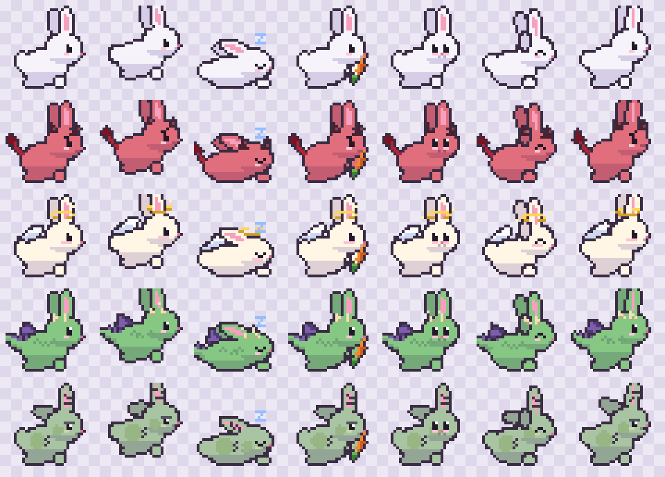

| Style | Extras | Default fur |
|---|---|---|
| Classic | the original bunny | `#F6F3FA` |
| Devil | small horns, a thin pointed tail, a red glint and a mischievous brow and smirk | `#E06E7C` |
| Angel | golden halo with sparkles, tiny feathered wings, rosier cheeks | `#FFF6E6` |
| Dragon | curved horns, little membrane wings, a spiky tail, scale marks | `#86C784` |
| Zombie | patchwork fur, stitched ear, one floppy ear, a sleepy, crooked little face | `#A9C4A2` |

Full frame sheets per style: [classic](images/sprites-classic.png) · [devil](images/sprites-devil.png) · [angel](images/sprites-angel.png) · [dragon](images/sprites-dragon.png) · [zombie](images/sprites-zombie.png).

**Fur colour on every style.** The fur, including the zombie's patches and the dragon's scales and tail, is tinted with your colour. Horns, halo, wings, stitches, eyes, nose and inner ears keep their own colours.

Picking a style switches to that style's default fur colour, unless you've chosen your own colour, in which case your colour stays (even if it's white, or matches another style's default). **Reset Color** (or `/bunny color reset`) removes your colour, so the current style's default applies, and later style changes follow each style's own colour again. The preview next to the colour picker always shows the selected style in its current colour.

Changing style never restarts what the bunny is doing: a sleeping bunny keeps sleeping in its new look.

## Personalities and moods (v0.4)

Personalities and moods change **which** of these animations the bunny picks, and how long it waits between them. They never change animation speed, timing or sprites.

**Personality** (setting; `/bunny personality …`): a small table of multipliers on the scheduler's existing knobs. Hopping is whatever is left after naps, burrows and idle behaviours, so a personality with fewer naps and shorter waits hops more.

| | Nap chance | Burrow chance | Idle-behaviour chance | Idle wait | Nap length | Favourite behaviours | Mood counters grow | Other |
|---|---|---|---|---|---|---|---|---|
| **Balanced** (default) | ×1 | ×1 | ×1 | ×1 | ×1 | none | normal | exactly the v0.3 mix |
| **Lazy** | ×2.2 | ×0.5 | ×1.3 | ×1.6 | ×1.5 | stretch ×1.5, wash ×1.2, look ×0.8 | tired ×1.5, energy ×0.6 | 30 % stretch after waking |
| **Energetic** | ×0.4 | ×1.2 | ×1.1 | ×0.6 | ×0.7 | look ×1.5, scratch ×1.3, stretch ×0.7 | tired ×0.7, hungry ×1.3, energy ×1.5 | |
| **Playful** | ×0.8 | ×2.0 | ×1.4 | ×0.9 | ×0.9 | carrot ×2, look ×1.5 | hungry ×1.2, energy ×1.8 | avoids its last *two* behaviours |
| **Sleepy** | ×2.5 | ×0.6 | ×0.9 | ×1.3 | ×1.6 | stretch ×1.4 | tired ×2, hungry ×0.8, energy ×0.5 | 60 % stretch after waking |

**Mood** (automatic; `/bunny mood`): changes only when an activity *finishes*, never on a timer or per frame. Three counters (tired, hungry, energy) move by fixed amounts per event, scaled by the personality's rates:

| Mood | Becomes active when | Effect on the next decisions | Ends when |
|---|---|---|---|
| **Happy** | default; no need is pressing | neutral (×1 everywhere) | a counter reaches its threshold |
| **Sleepy** | `tired` ≥ 6 (hops +1, burrows +1.5) | nap ×2, behaviour ×0.8, burrow ×0.6, wait ×1.2, stretch ×1.5 | a nap clears `tired` |
| **Hungry** | `hungry` ≥ 6 (hops +0.7, burrows +1, behaviours +0.5, naps +0.5) | idle behaviour ×1.6, carrot weight ×4 | a carrot clears `hungry` |
| **Playful** | `energy` ≥ 5 (naps +3, behaviours +1…1.5) | burrow ×1.8, nap ×0.6, wait ×0.8, look ×1.5, scratch ×1.2 | hops (−1) and burrows (−3) spend `energy` |

The highest counter that's over its threshold picks the mood. A mood lasts at least 3 events unless its need is met (a nap ends Sleepy, a carrot ends Hungry), which stops it flickering back and forth. Moods aren't saved: every session starts Happy. With the mood system off, only the personality applies.

## Style specials (v0.5)

Each style has one rare special of its own. Only the selected style's special ever plays.

| | Special | What happens | Length |
|---|---|---|---|
| 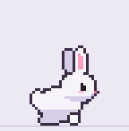 | **Classic: Carrot Celebration** | Notices something, tugs a **golden carrot** out of the ground and raises it high with a happy face. A flash on the carrot throws small orange and green twinkles that brake, drift up and wink out; the carrot glints while held. Then it hugs the carrot, which sparkles away. | 2.8 s |
| 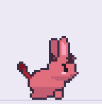 | **Devil: Mischievous Flame** | Rubs its paws with a sly grin, then raises one paw beside its forehead. A spark catches into a small outlined flame that sways, flickers and grows, shedding embers. The bunny snuffs it and the flame squeezes out into a puff of smoke. Smug face. | 2.9 s |
| 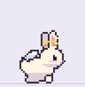 | **Angel: Heavenly Blessing** | Folds its paws and closes its eyes as its halo warms and glints. Gold dust puffs out as it **floats up 5 px**, bobs gently while gold sparkles and small white feathers rock down in front and behind, then lands softly. | 2.8 s |
| 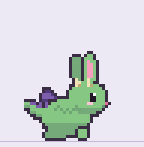 | **Dragon: Fire Sneeze** | Nose twitch, "ah…" (head back, smoke puffs from the nose), "ahh…", then **CHOO**. The head snaps forward and a short, snappy cone of flame bursts from the mouth, cools into a thin puff of smoke and leaves a few embers. A surprised look, a blink and a sheepish smile. | 2.7 s |
| 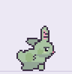 | **Zombie: Haunted Wisps** | Freezes and looks up as two green wisps and one purple one flicker in. They circle its head on a tilted orbit, passing **behind and in front of it** with short fading trails, while the bunny turns to watch. Then they come apart into tiny motes, and it shakes its ears. | 2.8 s |

Every special has anticipation, a main action, a distinctive effect, follow-through and recovery, and ends back on the idle pose.

**How often:**
- **Rare:** at most once every 6 minutes.
- **Normal (default):** at most once every 3 minutes.
- **Often:** at most once every 90 seconds.

The cooldown counts from login and from the last special. After it, a special is chosen on 30 % of the scheduler's decisions. Before the cooldown has passed the scheduler makes no extra random draw, so everything else behaves exactly as before.

**Personality and mood** scale that 30 % (Lazy ×0.7, Energetic ×1.2, Playful ×1.5, Sleepy ×0.6; Playful mood ×1.4, Sleepy ×0.7, Hungry ×0.8). A completed special counts as a mood event: hungry +0.5, energy +1.

**Turning them off:** the **Style-Specific Effects** setting or `/bunny effects off`. `/bunny test special` plays one now.

**How it's drawn:**
- **The body** (the bunny's own poses) comes from the same pose data as every other animation, in each style's `bunny-special.tga`. The fur takes your colour.
- **The effect** is drawn with [PixelFX](https://github.com/patch-gg/pixelfx) at development time. It's exported as an untinted 48 × 48 back and front layer per frame, in `bunny-special-fx.tga`.
- **In game:** frames are flipped every 0.1 s by the same timer as every other animation. Nothing is simulated or generated in game. See [art/pixelfx/README.md](../art/pixelfx/README.md).
- **Placement:** effects reach up to 16 px above the bunny's frame and 8 px to each side, never below its feet, so they don't cover the action buttons.

## Hopping (8 poses)

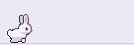

anticipation (crouch) → push-off → **rising** → **apex** → **falling** → contact → squash → recovery

| Phase | Time at speed 1.0 | How it's timed |
|---|---|---|
| Anticipation | 0.09 s | timer |
| Push-off | 0.05 s | timer |
| Air: rising / apex / falling | 0.4 s (setting `hopDuration`) | `OnUpdate`. The pose is picked by hop progress (< 38 % rising, < 64 % apex, then falling); position is the same parabolic arc as before. |
| Contact | 0.04 s | timer |
| Squash | 0.07 s | timer |
| Recovery | 0.06 s | timer; only after the last hop of a journey. The next hop otherwise starts straight from anticipation. |

All phases scale with `/bunny speed`. Progress uses real elapsed time, so the hop looks the same at any frame rate. Facing mirrors the frames for left travel.

## Idle behaviours

Between hops, the bunny sometimes (35 % of decisions, when enabled) does one of these instead. It never does the same one twice in a row.

### Carrot (about 4 s)

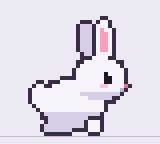

notice → sniff ×2 → pull (leaves showing) → carrot pops out → hold → **bite, chew** (full) → **bite, chew** (⅔) → **bite, chew** (⅓) → done (happy, tongue out).

### Face washing (about 1.8 s)
Paws up → rubbing (paws over the eyes, then the cheeks, three times, eyes closed) → ear wiggle ×2 → paws down.

### Ear scratching (about 1.5 s)
Sits back → hind foot up → scratching near the ear (10 quick strokes, blissful eyes) → foot down → sits.

### Stretching (about 1.5 s)
Reaches forward → deep stretch (chest low, rump up) → hold with ears back and a yawn → back up.

### Looking around (about 1.6 s)
Turns to face you → looks back over its shoulder (pause) → faces you → looks up → idle. Its facing doesn't change.

## Naps

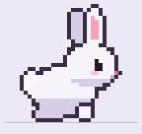

Unchanged from v0.2: getting sleepy (3 frames), lying down (4), a 4-frame breathing loop with occasional ear and nose twitches, then waking up (4).

## Burrowing (about 6 s, rare)

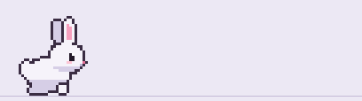

1. **Sniff** the ground.
2. **Dig**: paws scrape and dirt flies; a dirt mound grows into a hole.
3. **Sink**: four frames, each lower, with everything below the ground line cut away. The hole's front rim is drawn over the bunny, so it visibly goes *into* the hole.
4. **Underground** for 0.6 s. The bunny moves to the far side of its track while invisible.
5. **A second hole opens** (0.25 s).
6. **Ears first**, then the head, then a **pop** out of the hole.
7. **Shake** off the dirt.
8. **Both holes close** (two frames) and disappear.

The holes are BunnyBar's own textures on its own frame. The back layer sits behind the bunny and the front rim in front, aligned to the ground row; game terrain is never touched.

The destination is always inside the track, on the opposite side, so it works left-to-right and right-to-left.

**How rare:** at most once per cooldown (Rare 7 min, Normal 4 min, Often 2 min, counted from login and from the last burrow), and only on 35 % of decisions after that. It needs a track at least 1.5 bunny widths wider than the bunny.

**Interruptions:** hiding the bunny or the UI, `/bunny reset`, a size change or `/bunny test` at any point removes both holes, shows the bunny, cancels every timer and leaves the bunny at either the start or the end hole, never in between.

## Hover hearts

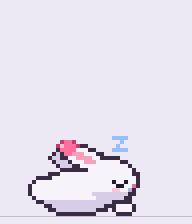

Hover over the bunny and small pink hearts rise from its head and fade out. Each one rises over 1.4 s and starts fading after 0.5 s.

| Intensity | A heart every | At most on screen |
|---|---|---|
| Subtle | 0.60 s | 3 |
| Normal (default) | 0.35 s | 6 |
| Extra | 0.18 s | 10 |

- **They never wake the bunny.** Hearts are a separate effect from the bunny's behaviour.
- **Only the bunny counts.** Hovering empty parts of the track does nothing. The hit area is the tight box of the frame currently shown (from the generated `SpriteData.lua`), mirrored for left-facing frames. An underground bunny can't be hovered.
- **Clicks still go through.** BunnyBar's frames never take the mouse, so the action buttons beneath stay usable.
- **No per-frame Lua.** Hearts are pooled textures animated with WoW's own animation system (`AnimationGroup` with Translation and Alpha) and hidden when they finish.
- **Hover detection is throttled.** The cursor is checked 4× a second when it's away from the track, 20× a second only near the track, and never while hearts are off or the bunny is hidden.
